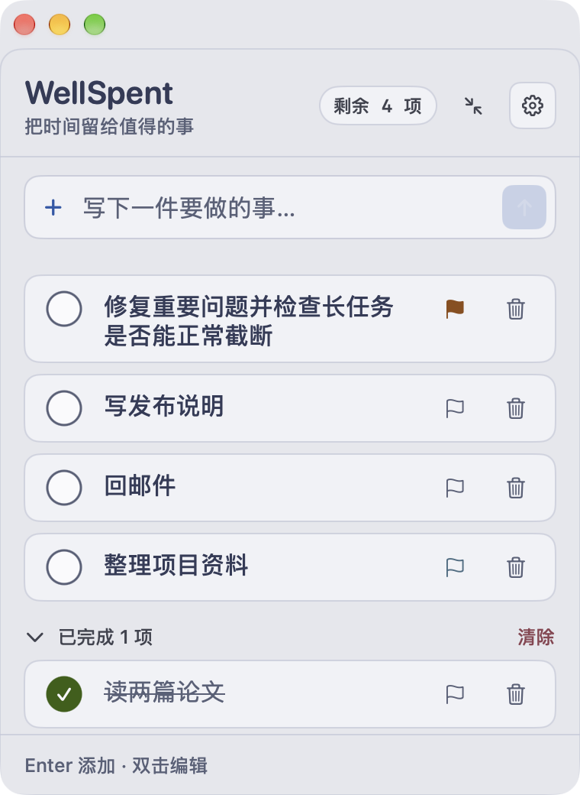
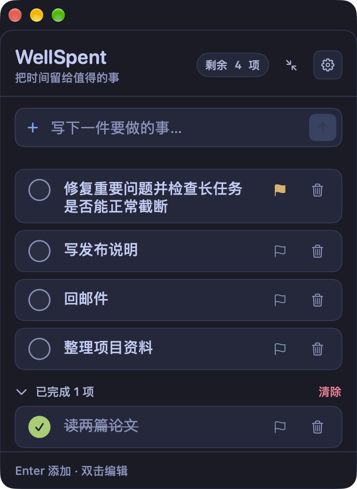

# WellSpent

> 把时间留给值得的事。

我想要的待办工具很简单：随手记，做完勾掉，然后继续做正事。WellSpent 是一扇留在 macOS 桌面角落的小窗，不打算把一件待办包装成一套工作流。

<p align="center">
  
  
</p>

## 下载

从 [GitHub Releases](https://github.com/Howell-Shinji/WellSpent/releases/latest) 下载最新 DMG，把 `WellSpent.app` 拖进「应用程序」。目前支持 Apple Silicon Mac（macOS 13 及以上），不支持 Intel Mac。

应用尚未签名或公证。首次启动如果被 macOS 拦截，可在 Finder 中右键点击 `WellSpent.app`，选择「打开」并确认。

## 怎么用

- 输入待办，按 `Enter` 添加。
- 点击圆圈标记完成或恢复未完成；已完成项收在下方，可以折叠。标题只统计剩余项。
- 点击任务右侧的旗帜设置优先级：暖金色为高、中性灰为普通、冷蓝色为低；悬停或打开菜单可查看等级说明。未完成项按等级排列，同级保持原有顺序。旧任务默认为普通。
- 双击文字编辑；`Enter` 保存，`Esc` 取消。长任务可以展开。
- 鼠标移入任务后显示垃圾桶；删除后 5 秒内可点击「撤销」。连续删除会重新计时，一次撤销可恢复这段时间内删除的全部任务。
- 鼠标移入窗口后显示齿轮，可选择跟随系统、浅色或深色模式，也可调整置顶和背景不透明度（30%–100%）。背景采用轻磨砂，文字和任务标记始终保持不透明；键盘聚焦或使用 VoiceOver 时，操作按钮也会显示。

## 几个设计决定

- **少打扰。** 窗口默认置顶，也能关闭置顶；位置和尺寸会记住。界面采用 Tokyo Night 配色，浅色与深色分别设计，不是简单反相。
- **数据留在本机。** 待办保存在 `~/Library/Application Support/WellSpent/`。没有账号、云同步或网络请求。
- **出错要说清楚。** 每次修改立即保存，并保留上一份有效备份。读取失败时不会把原文件当成空列表覆盖；保存失败会提示重试。

## 当前版本

v2.1.3 将透明度改为只影响背景，文字和任务标记保持清晰；加入轻磨砂、淡边框和悬停操作按钮。任务卡片保留薄底色，减少壁纸干扰。原有透明度设置会保留，系统开启「减少透明度」时使用不透明背景。

## 从源码构建

需要 Apple Silicon Mac、macOS 13+ 和 Xcode Command Line Tools。在仓库根目录运行：

```bash
bash ./WellSpent/scripts/test.sh
./WellSpent/scripts/build.sh
open "WellSpent/build/WellSpent.app"
```

需要 DMG 时，再运行 `./WellSpent/scripts/package-dmg.sh`。项目使用 SwiftUI + AppKit，不依赖第三方库；构建脚本直接调用 `swiftc`。

## 灵感来源

WellSpent 基于 [今天没白活](https://github.com/lijigang/JintianMeiBaihuo) 修改。视觉主题、外观模式、名称、图标与项目结构在此基础上重新设计。

## 许可

[MIT](LICENSE) © 2026 Howell · Scott · Stark
